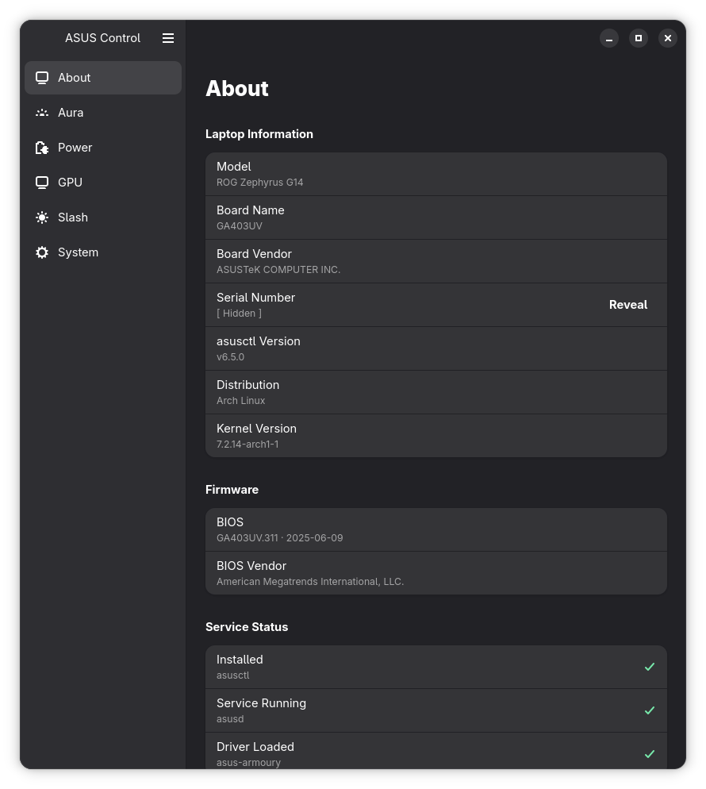
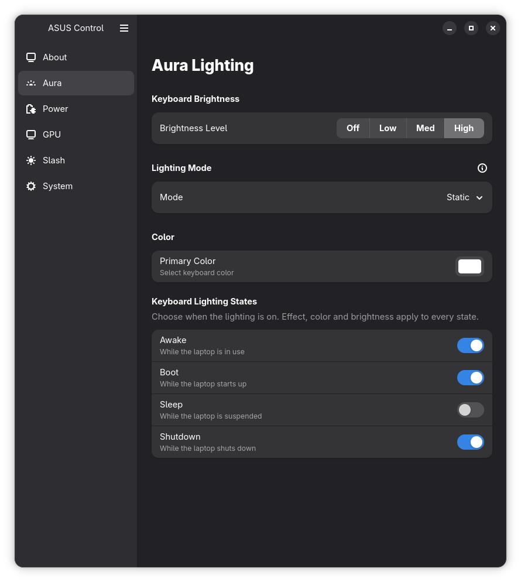
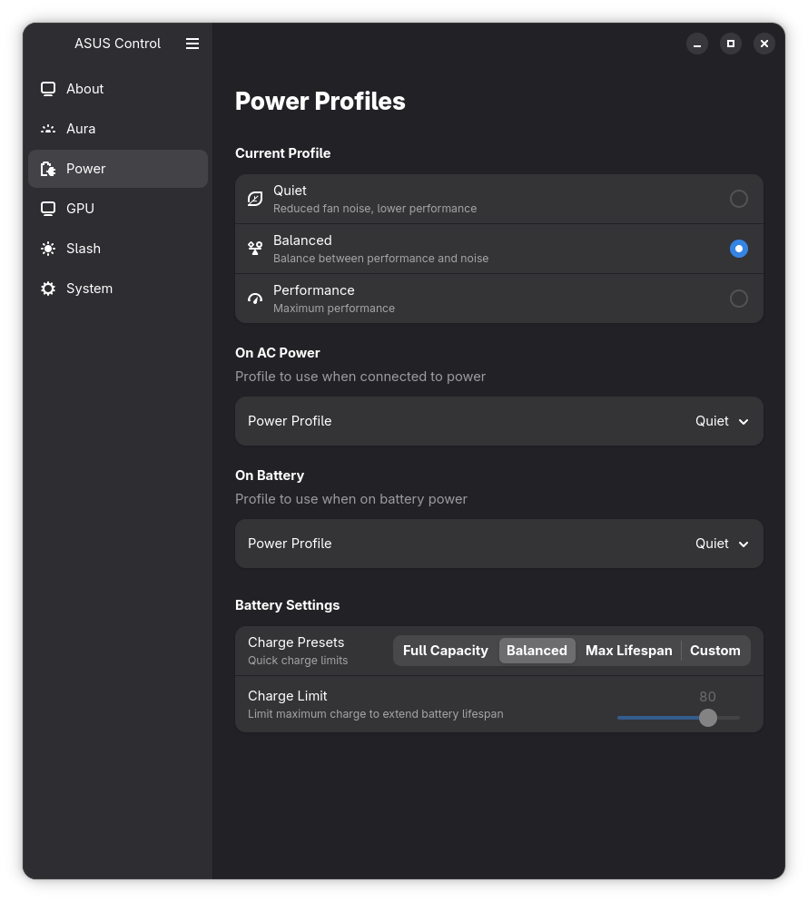
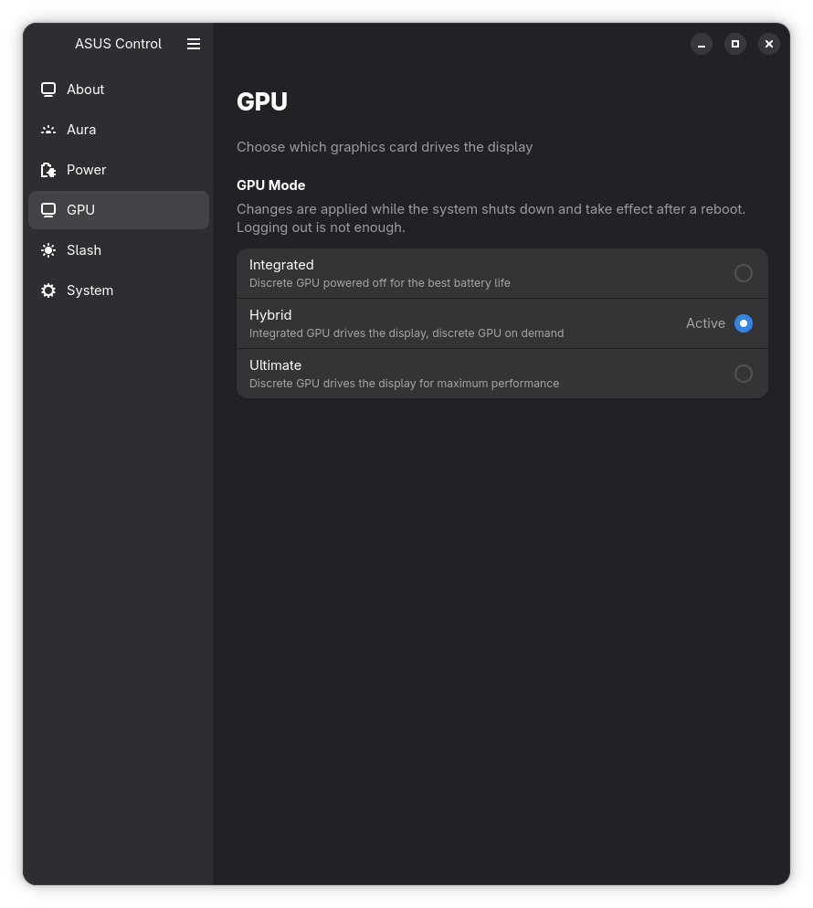
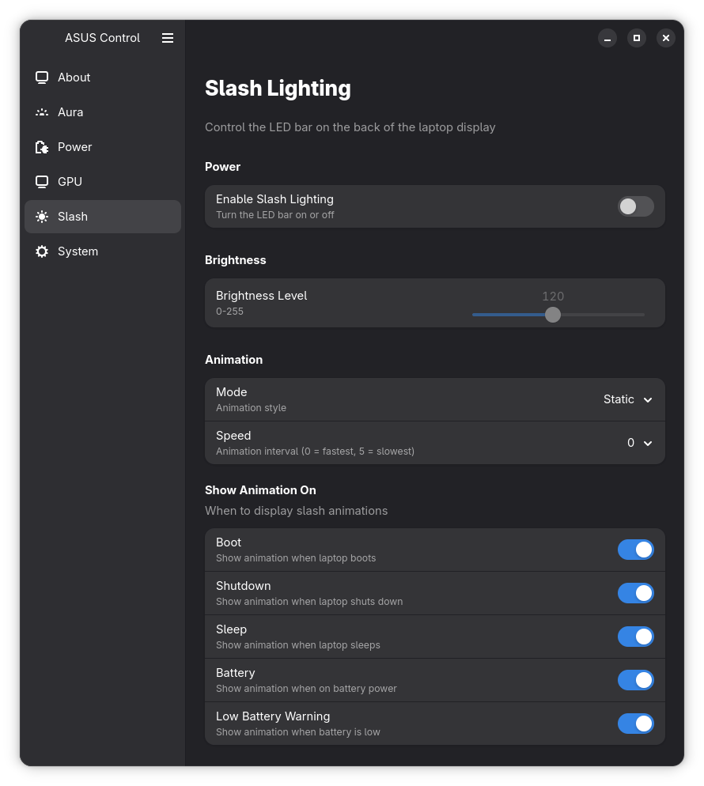
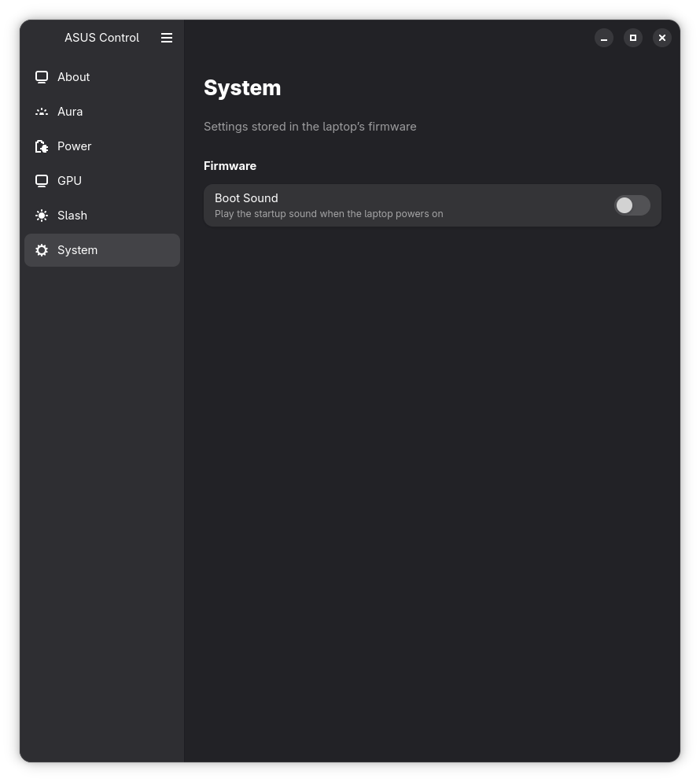

# asusctl-gui

[](https://github.com/Bl4ckspell7/asusctl-gui/actions/workflows/rust.yml)
[](https://github.com/Bl4ckspell7/asusctl-gui/actions/workflows/flatpak.yml)

A GTK4/Libadwaita GUI for [asusctl](https://github.com/OpenGamingCollective/asusctl) - manage your ASUS ROG laptop settings.

## Features

- **About** - View laptop info, driver status, and supported features
- **Aura** - Manage keyboard lighting modes, colors, and when the lighting is on
- **Power** - Set power profiles for AC/battery
- **GPU** - Switch between Integrated, Hybrid and Ultimate GPU modes (applied on reboot)
- **Slash** - Control slash lighting on the back of the display
- **System** - Turn the boot sound on or off
- **Keyboard shortcut** - Open the app with the ROG key (GNOME)

## Screenshots

|                About                 |                Aura                |
| :----------------------------------: | :--------------------------------: |
|  |  |

|                Power                 |               GPU                |
| :----------------------------------: | :------------------------------: |
|  |  |

|                Slash                 |                 System                 |
| :----------------------------------: | :------------------------------------: |
|  |  |

## Requirements

- [`asusctl`](https://github.com/OpenGamingCollective/asusctl) `6.4.0` or newer installed and configured

## Installation

Download `asusctl-gui.flatpak` from the [latest release](https://github.com/Bl4ckspell7/asusctl-gui/releases/latest) and install it:

```bash
flatpak install --user ./asusctl-gui.flatpak
flatpak run com.github.bl4ckspell7.asusctl-gui
```

Optionally, verify the download against `SHA256SUMS.txt` from the same release with `sha256sum -c SHA256SUMS.txt`.

## Development

See [DEVELOPMENT.md](DEVELOPMENT.md) for building from source, testing, and coverage instructions.

## AI Disclaimer

Portions of this code have been generated with assistance from AI tools. All AI-generated code is reviewed by the maintainer with the same standards applied to any other contribution.

## License & Trademarks

GPL-3.0

---

ASUS and ROG are trademarks or registered trademarks of ASUSTeK Computer Inc. in the United States and/or other countries.

Reference to any ASUS products, services, processes, or other information and/or use of ASUS trademarks does not constitute or imply endorsement, sponsorship, or recommendation thereof by ASUS.

The use of ROG and ASUS trademarks within this project is only to provide a recognisable identifier to users to enable them to associate that these tools will work with ASUS ROG laptops.
